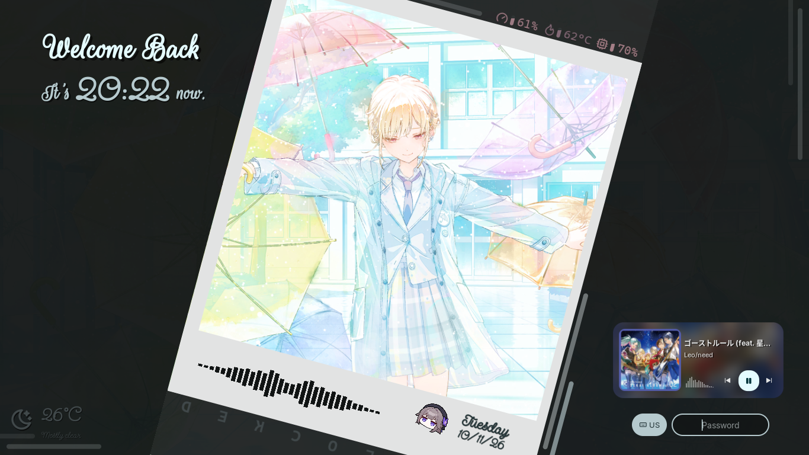
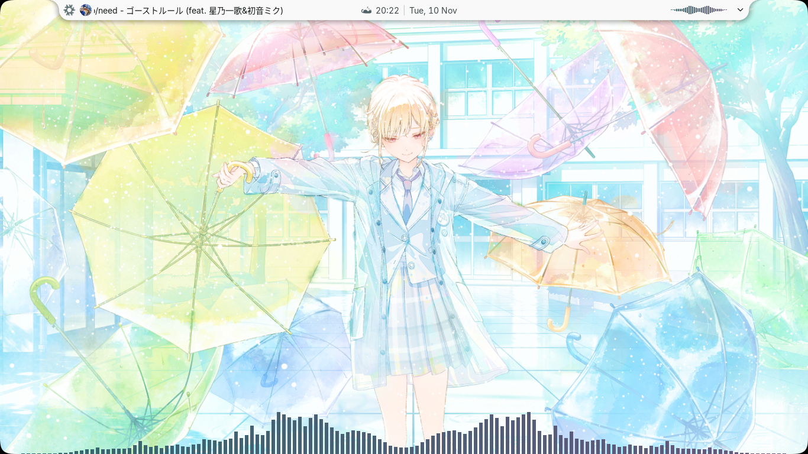
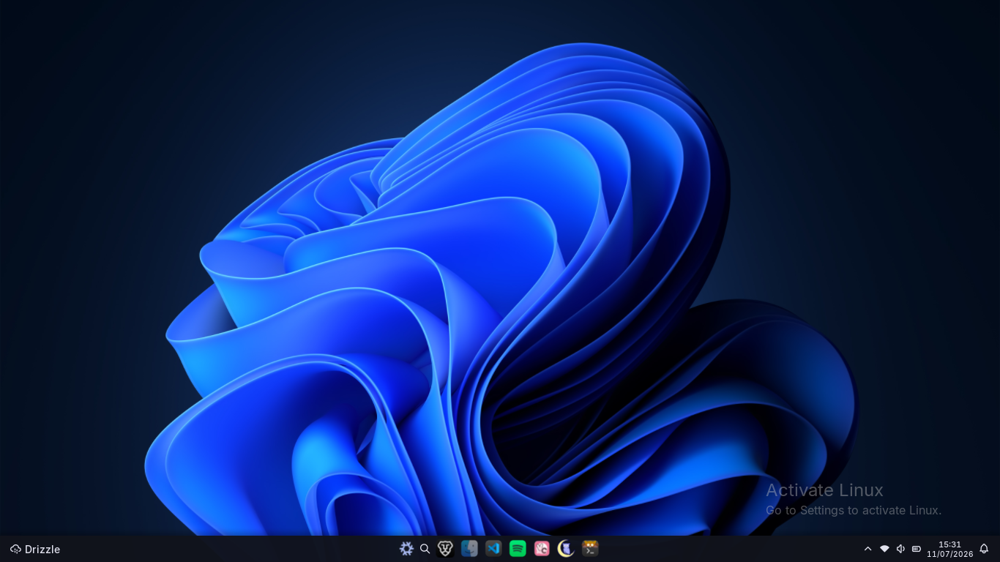

This is _my_ daily driver NixOS configuration.\
It's just a simple one machine config w/ flake and simple modular configs.

<h2 align="center">• Screenshots •</h2>

|  |  |
| :-----------------------------: | :--------------------------: |
|  Polaroid inspired lockscreen   |       Notch style bar        |
|       |                              |
|       Windows 11 like bar       |                              |

<i align="center">wallpaper from [Hatsune Miku: Colorful Stage!](https://www.colorfulstage.com/)</i>

<h2 align="center">• Installation •</h2>

As I said at the beginning I make this for _myself_ so just take what you want, you will have to modify it anyway.

<h2 align="center">• Acknowledgment •</h2>

- [@cherrblyria](https://github.com/cherrblyria): ...
- [@vimjoyer](https://youtube.com/@vimjoyer): Amazing Nix/NixOS tutorials
- [end_4's illogical impulse](https://github.com/end-4/dots-hyprland): Some beautiful dot files
- [Noctalia's Community](https://discord.com/invite/aU2vzNsQPc): Give me a lot of ricing inspirations

<h2 align="center">• Credits •</h2>

| Asset                                                                      | Source                                                                                                                                                         |
| -------------------------------------------------------------------------- | -------------------------------------------------------------------------------------------------------------------------------------------------------------- |
| [assets/images/herta\*](assets/images)                                     | [Honkai: Star Rail](https://hsr.hoyoverse.com/en-us/)                                                                                                          |
| [assets/cursors/mizuki-psekai-cursor](assets/cursors/mizuki-psekai-cursor) | [Hatsune Miku: Colorful Stage!](https://www.colorfulstage.com/media/download)                                                                                  |
| [assets/arts](assets/arts)                                                 | [textfancy](https://textfancy.com/text-art/), [emojicombos](https://emojicombos.com/dot-art-generator), [cuteinternet](https://www.cuteinternet.com/aesthetic) |
| [assets/fonts](assets/fonts)                                               | [Google Fonts](https://fonts.google.com/)                                                                                                                      |
