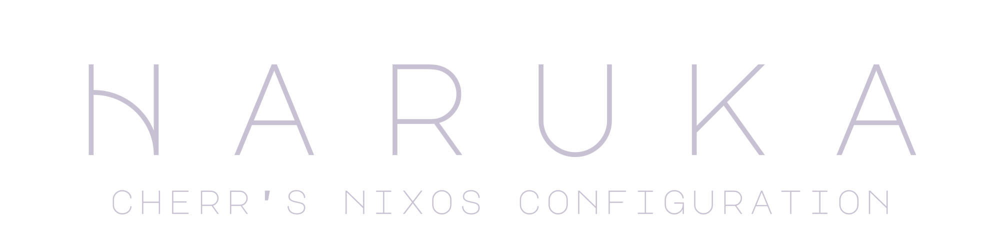

This is _my_ daily driver NixOS configuration.\
It's just a simple one machine config w/ flake and simple modular configs.

## • Screenshots •

|  |  |
| -------------------------------------------------------------------------------------------------------------- | ----------------------------------------------------------------------------------------------------------- |

### • In these pics •

- Shell: [Noctalia](https://noctalia.dev/)
- WM: [Niri](https://github.com/niri-wm/niri)
- Wallpaper: made by me :3
- Music: [สุรสีห์ อิทธิกุล - ปราสาททราย](https://open.spotify.com/track/2VmWsYUlnS3af8FOAyHS8k)

## • Installation •

As I said at the beginning I make this for _myself_ so just take what you want, you will have to modify it anyway.

## • Inspiration • Copying •

- [end_4's illogical impulse](https://github.com/end-4/dots-hyprland): Starship prompt design

## • Credit •

| Asset | Source |
| --- | --- |
| [assets/images/herta.png](assets/images/herta.png) | [Hoyolab](https://m.hoyolab.com/#/article/36359597) |
| [assets/cursors/mizuki-psekai-cursor](assets/cursors/mizuki-psekai-cursor) | [Hatsune Miku:Coloful Stage](https://www.colorfulstage.com/media/download) |
| [assets/arts](assets/arts) | [textfancy](https://textfancy.com/text-art/), [emojicombos](https://emojicombos.com/dot-art-generator), [cuteinternet](https://www.cuteinternet.com/aesthetic) |
| [assets/fonts](assets/fonts) | [Google Fonts](https://fonts.google.com/) |

## • Acknowledgment • Thanks •

- [@vimjoyer](https://youtube.com/@vimjoyer): Amazing Nix/NixOS tutorial
- [win2xcur](https://github.com/quantum5/win2xcur): A simple tools to convert Windows cursor to XCursor format.
